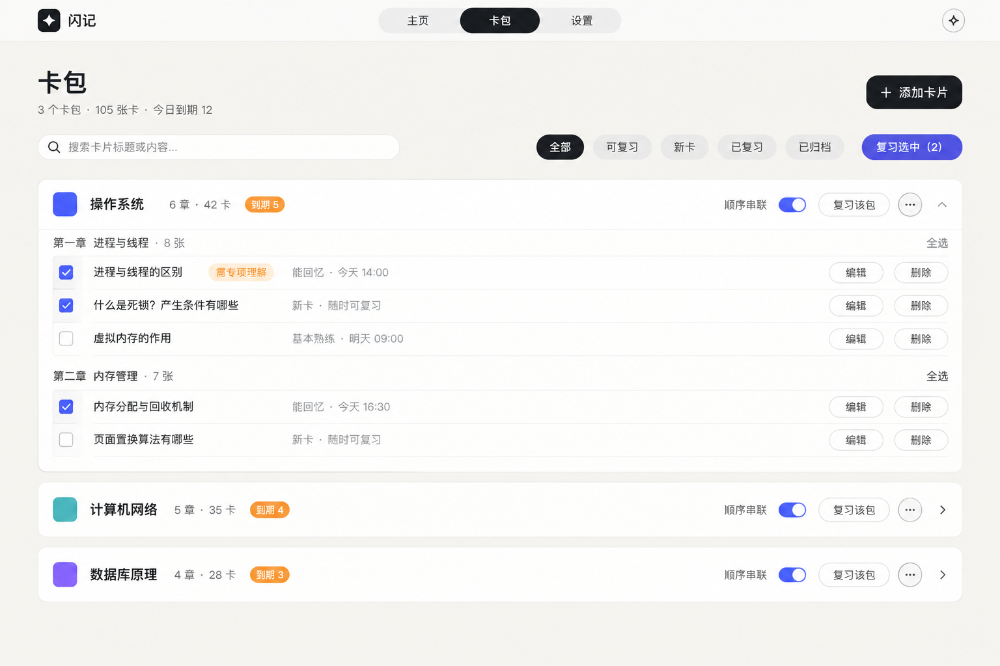
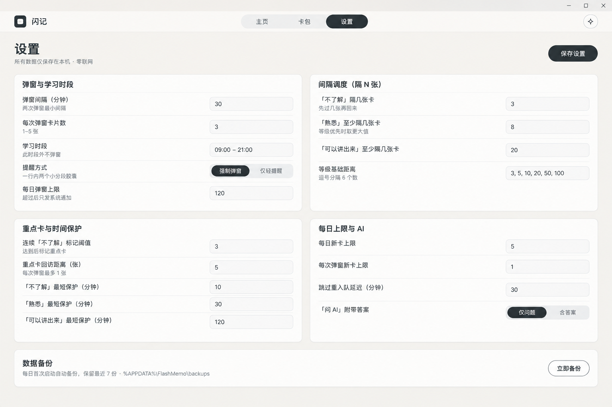

# 闪记 FlashMemo

常驻 Windows 托盘的闪卡复习工具：把 Markdown 笔记变成卡片，到点弹窗提醒，按「隔 N 张」的间隔重复节奏帮你把东西背下来。

**核心功能零网络、数据纯本地**——导入、调度、复习、存储全程不发任何请求，卡片数据不出 `%APPDATA%\FlashMemo`。

## 特性

- **Markdown 导入**：`#` 卡包 · `##` 章节 · `###` 卡片问题（其后内容为答案）。题面可以是一整段文字或截图（长题干 / 图片题）。
- **粘贴导入**：手边只有一段文本（AI 回答、聊天记录、网页）时，直接粘进「导入 → 粘贴文本」，一次变成多张卡，规则与文件导入完全一致。
- **定时弹窗复习**：常驻托盘，按设定时段与节奏弹出小窗；每次评分立刻落库，崩溃/断电不丢进度。
- **按「再隔几张卡」调度**：间隔以「中间还要过几张卡」计，而不是「隔几天」——背到后面自然拉长，不会被时间债务追着跑。
- **连贯闪卡**：同章节自动串联，复习时可看「知识铺垫」前置卡、可「顺链继续下一张」；也可手动连线。
- **疑难卡与归档抽查**：连击讲不出来会被标记为重点回访；讲得出来的卡自动归档，并按权重偶尔抽查，防止背完就忘。
- **今日目标**：设定今天要复习/讲出多少张，首页实时显示当前节奏。
- **复习中直接改卡**：弹窗里就能批注卡面（所见即所得），本地改过的卡片在下次重新导入时默认保留。
- **浏览器调试模式**：不需要打包，`npm run dev` 后在浏览器里用假数据点完整个流程（见下）。

## 界面

设计稿（1280×800）：

| 首页 | 卡包 |
| --- | --- |
|  |  |

| 复习弹窗 | 设置 |
| --- | --- |
|  |  |

## 快速开始

环境要求：Node.js 18+、Rust stable（MSVC 工具链）、Windows 10/11（WebView2 运行时，系统自带）。

```bash
npm install
npm run tauri dev      # 完整应用（热重载）
```

常用命令：

```bash
npm run dev            # 只起前端 → 浏览器调试模式
npm test               # 前端逻辑测试（Vitest）
cargo test             # Rust 核心测试（在 src-tauri/ 下执行）
npm run tauri build    # 打安装包
```

### 浏览器调试模式

前端不依赖 Tauri 也能跑：`npm run dev` 后打开

- `http://localhost:1420/` — 主窗口界面
- `http://localhost:1420/?window=popup` — 复习弹窗界面

此时 `src/lib/mockBackend.ts` 会用内存 + localStorage 的假数据接管全部命令，可以直接用 DevTools 定位 UI 问题、改样式、走完整个复习流程，不必等 Rust 编译。

## 导入格式

```markdown
# MySQL

## 事务

### ACID 是什么？
- **原子性**：不可分割
- **一致性**：从一个一致状态到另一个一致状态

### 隔离级别有哪些？
1. 读未提交
2. 读已提交
```

- `###` 之后的内容是卡片背面（答案）；`####` 及更深保留在卡面正文里。
- 长题干 / 图片题：用 `> [!question]` 标注块写题面，其余写答案。
- 章节里一个 `###` 都没有时，整段会成为**一张题面卡**（正面是全文、背面留空）。
- 导入是**幂等**的：以 `(卡包名, 章节名, 卡片标题)` 为唯一键更新，复习进度保留；在应用里改过的卡片默认保留本地版本。

完整规则见 [SPEC.md](./SPEC.md) §5。

## 数据与隐私

- 所有数据在 `%APPDATA%\FlashMemo`：`data.db`（SQLite）、`attachments/`（卡面图片，按内容哈希命名）、`backups/`（每日自动备份，保留最近 7 份）、`logs/`（运行日志，保留 7 天）。
- 导入/调度/复习/存储**零网络请求**；卡面里的远程图片一律不加载。
- 没有遥测、没有崩溃上报。详见 [PRIVACY.md](./PRIVACY.md)。

## 项目结构

```
src/                  React 18 + TypeScript 前端
  pages/              首页 / 卡包 / 导入 / 添加卡片 / 设置 …
  components/         复习弹窗等共享组件
  lib/                Tauri invoke 封装、Markdown 渲染、浏览器 mock 后端
src-tauri/src/        Rust 后端
  parser.rs           Markdown → 卡包/章节/卡片（纯函数）
  scheduler.rs        间隔重复调度（纯逻辑）
  db.rs               SQLite 连接、迁移、DAO
  commands.rs         Tauri command 层（薄壳：校验 + 委托）
  engine.rs           定时触发引擎
SPEC.md               产品与技术规格（唯一需求来源）
```

## 测试

```bash
cargo test                                  # Rust：解析、调度、数据库、导入
npx vitest run                              # 前端：解析镜像、编辑器、页面交互
cargo clippy --all-targets -- -D warnings   # Rust lint
npx tsc --noEmit                            # TypeScript 类型检查
```

## 状态

早期版本（0.1.0），作者自用中：导入、调度、弹窗、批注、连贯闪卡等核心闭环已完成并每日使用；开放前还在打磨界面与文档。

## 许可

[MIT](./LICENSE)
